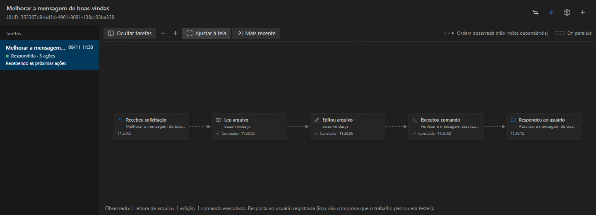
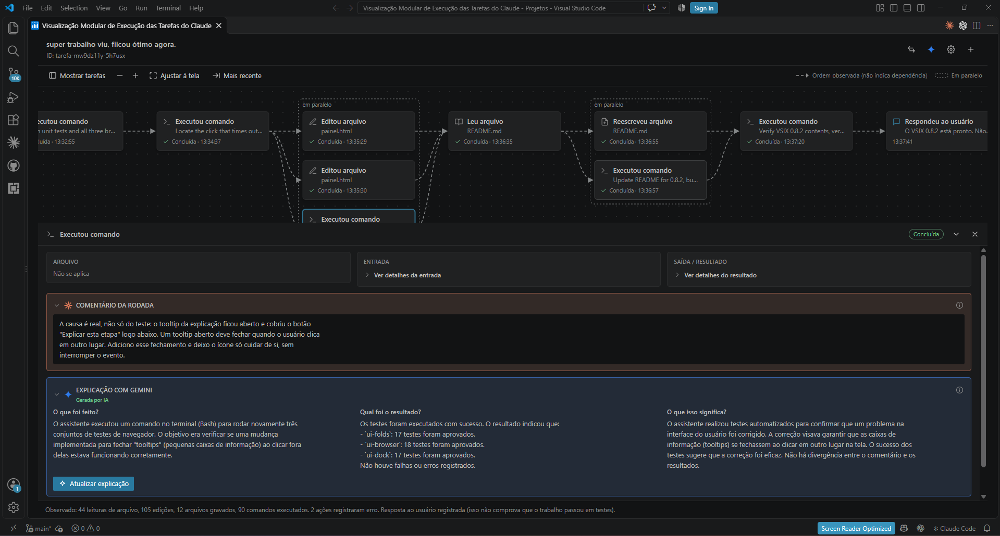
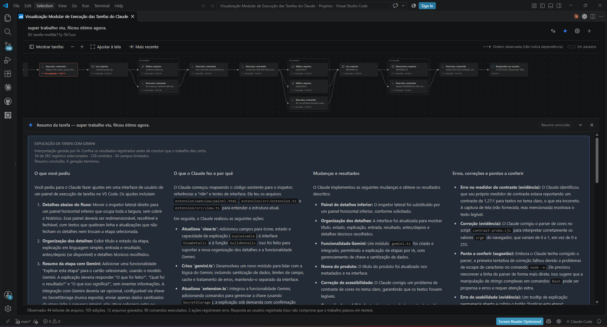
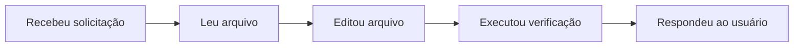
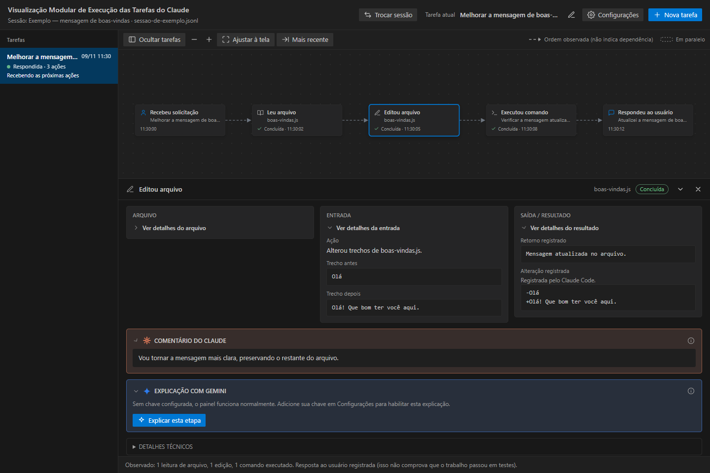
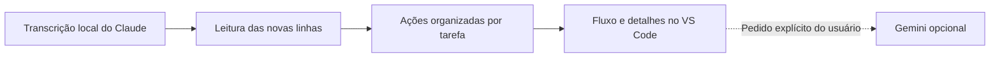

# Claude Task Viewer

### Visualização modular das tarefas do Claude, dentro do VS Code

Veja **o que o Claude Code leu, editou e executou**, acompanhe os resultados e entenda cada etapa sem precisar decifrar uma conversa cheia de termos técnicos.

## A dor que este projeto procura resolver

Quem está começando a usar um assistente de programação pode pedir uma mudança e receber uma sequência de nomes de arquivos, comandos e respostas sem entender o que aconteceu. **O Claude leu o quê? Mudou qual arquivo? Essa ação deu certo? Por que foi para a próxima etapa?**

Criei este projeto porque também estou aprendendo e queria uma experiência mais fácil: ver cada passo, abrir o resultado e acompanhar a explicação sem precisar dominar JavaScript, Git ou outra linguagem. O objetivo é ajudar a entender o trabalho, não ensinar todos os conceitos de programação nem garantir que o código esteja correto.

A implementação foi construída com Claude Code, com apoio do Codex na revisão, nos testes e na preparação da publicação.

**[Baixar a versão 0.10.0](https://github.com/alosiolemos/claude-task-viewer/releases/tag/v0.10.0)** · [Como instalar e usar](docs/como-usar.md) · [Código e testes](docs/desenvolvimento.md)

*A captura acima usa dados ilustrativos na interface da versão 0.9.4. As capturas da seção seguinte mostram o uso real compartilhado pelo autor.*

## A ferramenta em uso no VS Code

Capturas reais compartilhadas pelo autor durante o desenvolvimento do próprio projeto.

### Entenda uma etapa

O fluxo fica acima; abaixo, você consulta **Arquivo**, **Entrada**, **Saída / Resultado**, o comentário público do Claude e a explicação opcional do Gemini.

### Entenda a tarefa inteira

O resumo do Gemini organiza o pedido, as ações, os resultados e os pontos a conferir. A indicação de registros selecionados e omitidos ajuda a reconhecer os limites da explicação. É uma interpretação gerada por IA, não uma prova de que o código funciona.

*Clique em uma captura para abrir a imagem em tamanho maior. Os números e estados mostrados pertencem à execução capturada, não representam a contagem de testes da versão atual.*

## O que você consegue acompanhar

| Você quer saber… | Onde encontra |
| --- | --- |
| O que ele está fazendo? | Cartões de leitura, edição, comandos e resposta |
| Qual arquivo foi usado? | Nome curto no cartão e caminho nos detalhes |
| O que entrou e o que saiu? | Colunas **Arquivo**, **Entrada** e **Saída / Resultado** |
| O que mudou em uma edição? | Trechos antes/depois e alteração registrada, quando disponíveis |
| Por que ele fez isso? | Comentário público do Claude associado à ação ou à rodada |
| Preciso de uma explicação mais simples? | **Explicar esta etapa** ou **Explicar tarefa inteira**, com Gemini opcional e sua própria chave |

O painel **observa** o Claude. Ele não programa por você, não executa os comandos exibidos e não altera seus arquivos.

## Do pedido ao resultado

As linhas do painel representam a **ordem observada**, não uma dependência comprovada. Ações que pertencem à mesma resposta podem aparecer agrupadas em paralelo. Uma falha intermediária fica visível na ação; uma resposta final não significa, por si só, que o trabalho passou em testes.

## Clique para entender uma etapa

As informações abrem **abaixo do fluxo**, em um painel de altura ajustável. Os conteúdos ficam recolhidos para facilitar a leitura; você expande somente o que precisa.

- **Arquivo:** nome, caminho completo e botão para copiar.
- **Entrada:** parâmetros e trechos anteriores/novos, quando registrados.
- **Saída / Resultado:** retorno, alteração ou erro registrado.
- **Comentário do Claude:** texto público da mesma mensagem; nunca raciocínio interno. Quando cobre várias ações, é identificado como comentário da rodada.
- **Explicação com Gemini:** interpretação opcional, identificada como gerada por IA e separada do comentário original.
- **Detalhes técnicos:** IDs e dados de referência, recolhidos por padrão.

## Instalar sem programar

Você precisa do **VS Code** e do **Claude Code gravando transcrições locais**. O fluxo de instalação e uso foi validado no Windows; outros sistemas ainda precisam de validação.

1. Abra a [página da versão 0.10.0](https://github.com/alosiolemos/claude-task-viewer/releases/tag/v0.10.0).
2. Em **Assets**, baixe **`painel-execucao-0.10.0.vsix`**. Esse é o instalador; não é necessário baixar o código-fonte.
3. No VS Code, abra **Extensões** (`Ctrl+Shift+X`), clique em **…** e escolha **Instalar a partir do VSIX / Install from VSIX**.
4. Selecione o arquivo baixado. Se o VS Code pedir, recarregue a janela.
5. Abra a mesma pasta em que está usando o Claude Code.
6. Pressione `Ctrl+Shift+P` e procure **Abrir Visualização de Execução do Claude**.

**Não precisa de terminal, npm, Python, servidor ou chave do Gemini para usar o painel básico.** O VSIX já vem pronto. Se aparecer um bloqueio de segurança do sistema, não desative a proteção: registre o erro para investigação.

## Novidades da versão 0.10.0

- Abaixo do título, o cabeçalho mostra a **Conversa** e o **Projeto · ID** de origem da tarefa exibida.
- A lista lateral reúne tarefas já acompanhadas em outras sessões, com busca e filtros por projeto e conversa. Abrir uma tarefa de outra conversa é só consulta: as novas ações continuam na tarefa ativa.
- O ícone **Exportar tarefa** salva a tarefa selecionada em HTML (relatório para ler ou imprimir) ou JSON (análise técnica), depois de uma revisão do que será incluído.

## Novidades da versão 0.9.4

O título e o identificador da tarefa ficam à esquerda do cabeçalho. À direita, passe o mouse pelos quatro ícones: **Trocar sessão**, **Explicar tarefa inteira com Gemini**, **Configurações** e **Nova tarefa**. O resumo abre abaixo do fluxo, em seções responsivas.

## Usar no dia a dia

1. Confira a sessão exibida; use **Trocar sessão** se precisar escolher outra.
2. Clique em **Nova tarefa** antes de iniciar um trabalho diferente no Claude.
3. Envie seu pedido ao Claude normalmente e acompanhe os cartões surgirem.
4. Clique em um cartão para consultar os detalhes.
5. Correções do mesmo trabalho continuam na tarefa atual. Para retomar outra tarefa do histórico, selecione-a e use **Continuar esta tarefa**.

Na primeira abertura, rodadas já concluídas ficam em **Histórico legado**. Se houver um pedido em andamento, ele e as ações seguintes ficam juntos na tarefa atual. Consultar uma tarefa antiga não muda automaticamente o destino das novas ações. **Ocultar tarefas** amplia a área do fluxo; **Mais recente** ajuda a voltar à última ação e **Ajustar à tela** mostra o conjunto.

> **Primeiro teste:** com uma nova tarefa criada no painel, peça ao Claude: “Leia o README.md e explique a finalidade do projeto. Não altere arquivos.” Observe a leitura e a resposta no mesmo fluxo.

[Veja o guia com solução de problemas e configuração do Gemini →](docs/como-usar.md)

## Gemini é opcional

Use **Configurações → Adicionar chave** para informar sua própria chave de API. Ela é armazenada no **SecretStorage do VS Code**; nenhuma chave do autor acompanha o projeto.

A explicação só é solicitada por clique: **Explicar esta etapa** usa a ação e seu comentário público; o ícone azul no cabeçalho explica a **tarefa selecionada**, incluindo seu pedido, ações, resultados, comentários públicos e respostas. Há uma confirmação própria para o resumo completo. Outras tarefas e raciocínio interno não são enviados.

O resumo apresenta cinco partes: o que você pediu; o que o Claude fez e por quê; mudanças e resultados; erros e pontos a conferir; e o que você pode aprender. Os dados são sanitizados e limitados a 48.000 caracteres e até 120 registros, com indicação de omissões e campos limitados. O painel aguarda até 90 segundos e identifica geração, conclusão ou resposta incompleta. Não há repetição automática ou fallback de provedor.

A sanitização reduz exposição; não garante remover toda informação confidencial presente em código ou resultados. Revise os dados antes do envio. O uso da API depende das cotas, preços e condições da conta do usuário. A assinatura do Claude não inclui automaticamente essa API. Sem chave, os detalhes locais continuam funcionando.

## Como funciona e quais são os limites

- Leitura direta dos registros locais em `~/.claude/projects`, respeitando `CLAUDE_CONFIG_DIR` e a pasta configurada no painel. A verificação padrão ocorre a cada **1,5 segundo**.
- Sem alteração ou cópia integral das transcrições. O VS Code guarda IDs, associações, títulos e preferências necessários para reconstruir a visualização.
- O formato dos registros é interno do Claude e pode mudar. Dados desconhecidos são sinalizados; sessões sem registro local não podem ser acompanhadas por essa leitura.
- A escolha entre **nova tarefa** e **continuação** é explícita; o painel não adivinha essa intenção pelo nome de uma pasta.
- Ações internas de subagentes ainda não aparecem como cartões próprios.
- Comentários só aparecem quando há texto público associado. O painel não inventa justificativas ou alterações ausentes dos registros.
- Explicações Gemini são interpretações e podem errar. O cache fica em memória enquanto a extensão estiver ativa.
- A exportação reproduz os registros da tarefa selecionada para consulta. O relatório não certifica a correção do código, e a sanitização não garante remover toda informação confidencial.

## Exemplo de relatório exportado

[Veja um exemplo JSON reduzido e com dados genéricos](docs/examples/exportacao-resumida.json). Ele mostra a origem, o objetivo e as etapas de uma tarefa sem expor a conversa original, caminhos locais, comandos ou credenciais. [Entenda o exemplo](docs/examples/README.md).

## Ideias para depois — ainda não disponíveis

- Comparar execuções, suporte completo a subagentes e outros assistentes.

## Para explorar e contribuir

- [Instalação, tarefas, Gemini e dúvidas comuns](docs/como-usar.md)
- [Arquitetura atual, testes e desenvolvimento](docs/desenvolvimento.md)
- [Referências e ferramentas relacionadas](docs/referencias.md)
- [Histórico de mudanças](CHANGELOG.md)
- [Reportar um problema ou sugerir melhoria](https://github.com/alosiolemos/claude-task-viewer/issues)

Ao abrir uma issue, informe a versão e descreva o que esperava ver. Não envie chaves, transcrições completas ou screenshots com dados privados.

**Nome do repositório:** Claude Task Viewer. O nome interno da extensão e dos instaladores continua `painel-execucao`, preservando a identidade das instalações existentes.

Projeto independente, inspirado em fluxos visuais como os do n8n. Sem vínculo oficial com Anthropic, Google ou n8n. Os nomes e marcas pertencem aos respectivos titulares. Código sob [licença MIT](LICENSE).
