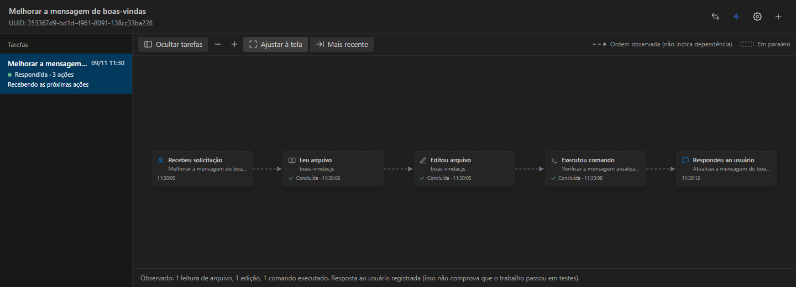
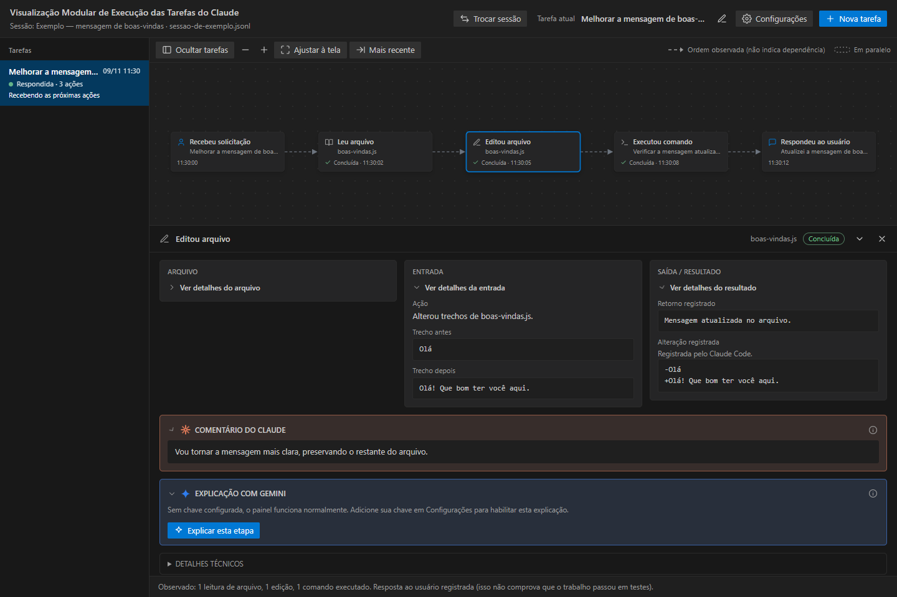

# Como instalar e usar

[← Voltar à apresentação](../README.md)

## Instalação

1. Baixe **painel-execucao-0.9.4.vsix** nos [Assets da versão 0.9.4](https://github.com/alosiolemos/claude-task-viewer/releases/tag/v0.9.4).
2. No VS Code: **Extensões → … → Instalar a partir do VSIX**.
3. Selecione o arquivo e recarregue a janela se solicitado.
4. Abra a pasta em que está trabalhando com o Claude Code.
5. `Ctrl+Shift+P` → **Abrir Visualização de Execução do Claude**.

Para atualizar uma instalação existente, instale o VSIX novo e use `Ctrl+Shift+P` → **Developer: Reload Window** depois de salvar o trabalho. O código-fonte ZIP do GitHub não é o instalador.

## Escolher a sessão certa

O cabeçalho identifica a transcrição acompanhada. Clique em **Trocar sessão** para escolher outra conversa do mesmo projeto.

Se a transcrição não for encontrada, use a seleção de pasta oferecida pelo painel ou configure `painel-execucao.transcriptsDir` nas configurações do VS Code. Escolha a pasta que contém os arquivos `.jsonl` da sessão. Quando o workspace é uma pasta acima do projeto usado pelo Claude, pode ser necessário selecionar o diretório correto manualmente.

O aplicativo usa os arquivos locais do Claude Code. Ele não lê automaticamente qualquer conversa de claude.ai nem controla a janela do Claude.

## Separar trabalhos sem perder o histórico

| Ação | Quando usar |
| --- | --- |
| **Nova tarefa** | Antes de mandar um pedido sobre um trabalho diferente |
| **Selecionar no histórico** | Para consultar uma tarefa anterior; não altera a tarefa que recebe novas ações |
| **Continuar esta tarefa** | Para direcionar as próximas ações à tarefa exibida |
| **Renomear tarefa** | Para trocar um título automático por um nome que você reconhece |

Na primeira abertura, rodadas anteriores concluídas ficam no **Histórico legado**. Se o último pedido ainda estiver em andamento, ele inicia a tarefa atual e permanece junto das ações e da resposta. Novas ações vão para a tarefa atual; se não houver uma, a próxima ação pode iniciar uma tarefa. Dar nome antes de trabalhar ajuda a manter o histórico organizado.

## Navegar e abrir os detalhes

- **Ocultar tarefas / Mostrar tarefas:** recolhe a lista lateral.
- **Ajustar à tela:** enquadra o fluxo.
- **Mais recente:** leva à ação mais recente.
- **Zoom e arraste:** ajudam a navegar sem alterar os registros.
- **Clique no cartão:** abre os detalhes abaixo do fluxo.
- **Puxador do painel inferior:** altera a altura; as setas do teclado também funcionam quando ele está focado.
- **Triângulos:** expandem ou recolhem os conteúdos. O ícone de informação explica o significado da seção por mouse, teclado ou clique.

**Concluída** descreve a ação registrada. **Erro registrado** identifica uma falha da ferramenta. **Respondeu ao usuário** significa que houve uma resposta final na rodada, não uma prova de que o resultado está correto.

## Entender uma edição

Em **Entrada**, você encontra os trechos fornecidos para alteração. Em **Saída / Resultado**, vê o retorno e a alteração registrada quando disponíveis. **Comentário do Claude** é o texto público da mesma mensagem. **Comentário da rodada** cobre várias ações da mesma resposta.

O painel não reconstrói um resultado histórico usando a versão atual do arquivo. Se o registro não trouxer uma informação, ela pode não estar disponível. As capturas deste guia usam dados ilustrativos na interface real.

## Configurar o Gemini, se quiser

1. Tenha uma chave pessoal obtida no [Google AI Studio](https://aistudio.google.com/apikey).
2. No painel, abra **Configurações → Adicionar chave**.
3. Cole a chave no campo oculto do VS Code e confirme.
4. Escolha uma ação que já tenha resultado e clique em **Explicar esta etapa**.
5. Revise a confirmação inicial dos dados que serão enviados.

A chave fica no SecretStorage do VS Code, não em `.env`, no HTML ou no repositório. O autor não fornece uma chave ou créditos. A cota e eventual cobrança são da sua conta Google; confira as condições antes de usar.

A explicação responde “O que foi feito?”, “Qual foi o resultado?” e “O que isso significa?”. Comentário original e explicação gerada por IA têm identificações diferentes. Atualizações, tooltips e seções recolhíveis não solicitam explicações automaticamente.

Você pode substituir ou remover a chave em Configurações. O modelo implementado é `gemini-2.5-flash`; sua disponibilidade e cota dependem do serviço. Não há fallback para outro provedor. Nesta publicação não foi feita uma nova chamada real ao Gemini.

## Se algo não aparecer

| Situação | Confira |
| --- | --- |
| Nenhuma ação nova | A sessão selecionada é a mesma em que o Claude está trabalhando? Há transcrição local? |
| Tudo no histórico legado | Era conteúdo anterior à primeira abertura. Crie uma tarefa e faça uma ação nova. |
| Ações chegando em outra tarefa | Selecione a tarefa desejada e use **Continuar esta tarefa**. |
| Resultado ainda não disponível | A chamada pode estar em andamento ou não ter um resultado gravado. |
| Formato não reconhecido | Anote a versão do Claude e o aviso; não envie a transcrição completa. |
| Gemini sem chave ou sem cota | Confira Configurações e a mensagem retornada. O painel local continua utilizável. |
| Arquivos antigos de captura | A versão atual lê transcrições diretamente. Não é necessário instalar collector.js ou hooks para usar essa versão. |

Para reportar um problema, use as [issues](https://github.com/alosiolemos/claude-task-viewer/issues) com versão, passos e uma captura sem informações confidenciais.

## Explicar toda a tarefa

No cabeçalho, o ícone azul do Gemini gera uma explicação da tarefa selecionada, no painel inferior. Não é necessário selecionar um cartão. São cinco seções para ajudar a entender e aprender com o processo. Os ícones de configurações e nova tarefa continuam à direita; seus nomes aparecem ao passar o mouse ou focar pelo teclado.

Na primeira vez, confirme o envio dos registros da tarefa, incluindo o pedido e as respostas. Somente essa tarefa é considerada; histórico legado não pode ser enviado como tarefa única. A interface informa dados omitidos e campos limitados. O texto é uma interpretação de IA, não uma prova de que o código funciona.

Enquanto gera, aparecem três pontos animados. O prazo do resumo é de até 90 segundos. Respostas interrompidas ou sem as cinco seções são identificadas como incompletas e não ficam em cache como sucesso. Uma nova tentativa depende de clique e pode consumir sua cota. Não há fallback nem novas chamadas automáticas.
